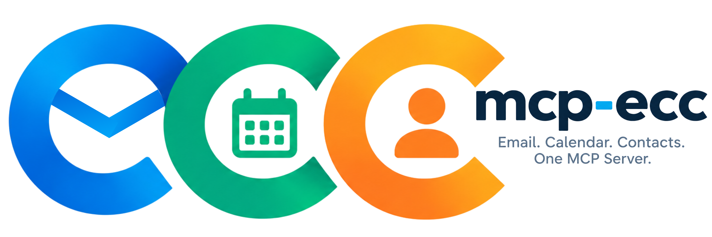

<div align="center">



# mcp-ecc

### Email · Calendar · Contacts — one MCP server for all your accounts

A Model Context Protocol (MCP) server that lets AI assistants read, write and manage your **email, calendar and contacts** — across **Google, Microsoft 365/Outlook, Zoho, and any IMAP/SMTP, CalDAV or CardDAV account** — from a single interface.


[](https://github.com/sponsors/karljsamuel)


</div>

---

**mcp-ecc** aggregates your mail, calendar and contacts into standardised MCP tools (`mail.*`, `calendar.*`, `contacts.*`, `accounts.*`) so any MCP client — Claude, Cursor, and others — can work with all of them uniformly.

- **One OAuth consent** per cloud provider covers mail + calendar + contacts
- **Multi-user** — users self-manage their own accounts, each with a per-user MCP API key
- **Credentials encrypted at rest** (AES-256-GCM)
- **Self-hostable** — single container serving a web admin UI, REST API and the MCP endpoint on one port

---

## Quick start

### Docker

```bash
docker run -d --name mcp-ecc \
  -p 127.0.0.1:3001:3001 \
  -v mcp-ecc-data:/data \
  karljsamuel/mcp-ecc:latest
```

Publish the port on `127.0.0.1` as above. The container listens on `0.0.0.0`
internally so the published port can reach it — the loopback restriction on the
*host* side is what keeps it off your network. Put a reverse proxy or tunnel in
front before widening that.

With no configuration the container starts in **setup mode**. Read the one-time
setup token from the logs:

```bash
docker logs mcp-ecc 2>&1 | grep "Setup token:"
```

Then open **http://127.0.0.1:3001/setup**, paste the token, and work through the
wizard: choose SQLite or Cloudflare D1, let it **verify the connection**, generate
an encryption key, set the server options, and create the first admin account.

While setup is incomplete, every API route except `/api/setup/*` answers `503`.
The setup token is the only thing protecting that page until an admin exists, so
do not publish the port beyond loopback until setup has completed.

#### Volume permissions (bind mounts)

The container runs as **uid 1001** (the `mcp-ecc` user), not root. A **named volume**
is seeded with that ownership automatically. A **bind mount** is not — Docker mounts
the host directory exactly as it is, so if it is owned by `root` the app can read it
but cannot write, and you get `EACCES: permission denied` on `/data` (or a database
that never initialises).

If you use a bind mount — as `docker-compose.yml` does with `./data:/data` — prepare
the directory with the container's uid before starting:

```bash
mkdir -p ./data
sudo chown -R 1001:1001 ./data
sudo chmod 2775 ./data     # optional: keeps group access for host users
```

Then confirm from inside the container:

```bash
docker exec mcp-ecc sh -c 'touch /data/.probe && rm /data/.probe && echo writable'
```

Symptoms of getting this wrong: a `permission denied` line in `docker logs`, a
crash/restart loop, and a **502** from your reverse proxy or tunnel because nothing
ends up listening on the published port.

#### The `.env` must sit beside `docker-compose.yml`

Compose interpolates `${MCP_ENCRYPTION_KEY}`, `${CLOUDFLARE_API_TOKEN}` and friends
from a `.env` in the **same directory as the compose file**. If that file is missing
or misnamed, every variable resolves to an empty string and the container starts in
**setup mode** — which looks like an outage: `/health` returns `200` while `/mcp` and
`/api/*` return `503`, and the logs say `is unconfigured and running in SETUP MODE`.

Check that the file is where compose expects it, and that the keys are actually
present (this prints variable names only, never values):

```bash
ls -la /path/to/compose-dir/.env
grep -oE '^[A-Z_]+=' /path/to/compose-dir/.env
```

Note that environment variables are captured when a container is **created**. If you
edit `.env` or rotate a credential, recreate the container — `docker compose up -d
--force-recreate` — or the running container keeps the old values.

#### The CLI is on `PATH` inside the container

The image links `mcp-ecc` into `/usr/local/bin` (→ `/app/packages/cli/dist/bin.js`), so the
CLI is available by name with nothing installed on the host — for stdio MCP clients,
maintenance, and the setup flow:

```bash
docker exec -it mcp-ecc mcp-ecc --help
```

#### Persisting the generated configuration

A `.env` written inside a container is lost when the container is recreated, so
the wizard hands you the content through a **copy** button instead of writing it.
Put it somewhere durable and give it to the container by reference:

```bash
# paste the copied content into ./mcp-ecc.env first
docker rm -f mcp-ecc
docker run -d --name mcp-ecc \
  -p 127.0.0.1:3001:3001 \
  -v mcp-ecc-data:/data \
  --env-file ./mcp-ecc.env \
  karljsamuel/mcp-ecc:latest
```

Alternatively, mount a writable location and point `MCP_ENV_FILE` at it. The
wizard then writes the file itself — no copy step, no restart — because the path
is known to survive:

```bash
docker run -d --name mcp-ecc \
  -p 127.0.0.1:3001:3001 \
  -v mcp-ecc-data:/data \
  -e MCP_ENV_FILE=/data/.env \
  karljsamuel/mcp-ecc:latest
```

#### Behind Cloudflare Tunnel or another reverse proxy

Set `PUBLIC_URL` to the public address — OAuth callbacks and the MCP endpoint URL
are built from it, so `localhost` will break them:

```bash
-e PUBLIC_URL=https://mcp-ecc.example.com
```

If you put Cloudflare Access in front, leave a bypass for `/mcp`: MCP clients
authenticate with per-user Bearer keys and cannot complete an interactive login.


### Web UI

```bash
mcp-ecc setup          # or: start the API unconfigured and open /setup
```

Either path walks the same steps: pick SQLite or Cloudflare D1, **verify the connection actually works**, generate an encryption key, set the server options, write `.env`, then create the first admin account.

### CLI (npm)

```bash
npm install -g mcp-ecc
mcp-ecc setup      # first run — writes .env and creates the admin account
mcp-ecc            # interactive TUI — login, add accounts, manage everything
mcp-ecc start      # stdio MCP server for agent hosts
```

### From source

```bash
git clone https://github.com/karljsamuel/mcp-ecc.git
cd mcp-ecc
npm install
npm run build
node packages/cli/dist/bin.js --help
```

---

## Upgrading to 0.7.0

> **This release invalidates stored credentials. Every account must be re-authenticated once after upgrading, and per-user API keys are regenerated. Back up your database first if you want a rollback path.**

### What changed

Credential encryption was rebuilt from scratch:

- **One canonical ciphertext format** shared by both backends: `base64(iv[12] || authTag[16] || ciphertext)`, AES-256-GCM.
- **Per-owner key derivation.** The data key is derived with HKDF-SHA256 over `MCP_ENCRYPTION_KEY` using the owner id, instead of one global key. A value encrypted for one user cannot be decrypted as another.
- **Key rotation is supported.** Each encrypted row records a key generation in the database, so you can move to a new key and re-encrypt in batches while both generations remain readable.
- **CryptoJS is gone** — the dependency, the legacy reader, and the migration path with it. There is no automatic migration from pre-0.7 ciphertext.
- **No fallback key.** A missing or placeholder `MCP_ENCRYPTION_KEY` is a hard startup error. The key is never read from or written to the database.

### Why you must re-authenticate

Values written by earlier versions cannot be decrypted by this one, by design. Everything encrypted at rest — OAuth refresh tokens, OAuth client secrets, IMAP/SMTP app passwords — becomes unreadable. You can start from a fresh database, or upgrade in place and re-run the auth flow per account.

### If you were told to run 0.6.x first

That instruction is obsolete. `0.6.x` was an intermediate step toward a platform-crypto format; 0.7.0 supersedes it and removes both the intermediate step and the reader it depended on. Going straight from `0.6.0` to `0.7.0` is the supported path.

### Rotating the key

1. Set `MCP_ENCRYPTION_KEY` to the new key.
2. List the old key as `MCP_ENCRYPTION_KEY_PREVIOUS` in the form `"<generation>:<key>"` (comma or whitespace separated for several).
3. Call `rotateEncryptionKeys(batchSize)` on the storage adapter — rows are re-encrypted in batches and both generations decrypt during the changeover.
4. Once every row is rotated, drop `MCP_ENCRYPTION_KEY_PREVIOUS`.

Set `MCP_ENCRYPTION_KEY_GENERATION` explicitly when you rotate, so a later key is not renumbered into an earlier generation's slot.

## Connecting an MCP client

Point your client at the HTTP endpoint with your per-user API key (shown in the web UI under **Settings**):

```json
{
  "mcpServers": {
    "mcp-ecc": {
      "type": "http",
      "url": "http://localhost:3001/mcp",
      "headers": { "Authorization": "Bearer <your-api-key>" }
    }
  }
}
```

Agents can read [`SKILL.md`](https://github.com/karljsamuel/mcp-ecc/blob/main/SKILL.md) or [`llms.txt`](https://github.com/karljsamuel/mcp-ecc/blob/main/llms.txt) for guided, automated setup.

---

## Providers

| Provider | Mail | Calendar | Contacts | Authentication |
|----------|:---:|:---:|:---:|------|
| **Google** (Gmail, Calendar, People) | ✅ | ✅ | ✅ | OAuth 2.0 |
| **Microsoft 365 / Outlook** (Graph) | ✅ | ✅ | ✅ | OAuth 2.0 |
| **Zoho** (Mail, Calendar, Contacts) | ✅ | ✅ | ✅ | OAuth 2.0 |
| **IMAP / SMTP** (any mail server) | ✅ | ❌ | ❌ | App password |
| **CalDAV** (Nextcloud, Radicale, BAIKAL) | ❌ | ✅ | ❌ | Password |
| **CardDAV** | ❌ | ❌ | ✅ | Password |

> **Microsoft 365:** app passwords are being retired — use OAuth (Microsoft Graph) only.

> **CalDAV/CardDAV compatibility:** the providers implement standard WebDAV (CalDAV RFC 4791, CardDAV RFC 6352) with Basic auth and should work with any standards-compliant server. **Tested against Radicale 3.7.8.** Not tested against other servers; OAuth-only providers (e.g. iCloud without an app-specific password) are not supported.

Deployment notes: Google/Microsoft/Zoho/IMAP/SMTP/CalDAV/CardDAV run under Node.js (CLI or Docker). Cloudflare D1 can be used as a hosted alternative for the local SQLite database.

---

## MCP tools

```text
mail.listFolders · mail.listMessages · mail.getMessage · mail.sendMessage
mail.searchMessages · mail.moveMessage · mail.setFlags · mail.deleteMessage

calendar.listCalendars · calendar.listEvents · calendar.getEvent · calendar.freeBusy
calendar.createEvent · calendar.updateEvent · calendar.deleteEvent

contacts.list · contacts.get · contacts.create · contacts.update
contacts.delete · contacts.search

accounts.list · accounts.get · accounts.add · accounts.remove · accounts.sync
```

Full reference with input schemas: [`docs/mcp-tools.md`](https://github.com/karljsamuel/mcp-ecc/blob/main/docs/mcp-tools.md)

---

## Documentation

- **[Getting started](https://github.com/karljsamuel/mcp-ecc/blob/main/docs/README.md)** — overview and quick start
- **[CLI reference](https://github.com/karljsamuel/mcp-ecc/blob/main/docs/cli.md)** — every `mcp-ecc` command and workflow
- **[Auth & users](https://github.com/karljsamuel/mcp-ecc/blob/main/docs/auth-users.md)** — multi-user model, bootstrap, per-user API keys
- **[Accounts & identity](https://github.com/karljsamuel/mcp-ecc/blob/main/docs/accounts-identity.md)** — name vs slug
- **Deployment** — [CLI](https://github.com/karljsamuel/mcp-ecc/blob/main/docs/deployment-cli.md) · [Docker](https://github.com/karljsamuel/mcp-ecc/blob/main/docs/deployment-docker.md)
- **Providers** — [Google](https://github.com/karljsamuel/mcp-ecc/blob/main/docs/providers-google.md) · [Microsoft 365](https://github.com/karljsamuel/mcp-ecc/blob/main/docs/providers-microsoft.md) · [Zoho](https://github.com/karljsamuel/mcp-ecc/blob/main/docs/providers-zoho.md) · [IMAP/SMTP](https://github.com/karljsamuel/mcp-ecc/blob/main/docs/providers-imap-smtp.md) · [CalDAV/CardDAV](https://github.com/karljsamuel/mcp-ecc/blob/main/docs/providers-caldav-carddav.md)

---

## Contributing

Feature branches off `dev`; PRs against `dev`. Run `npm run build` to compile all packages. Keep `Changelog.md` and `docs/` in sync.

## Support & Contributions

If you find `mcp-ecc` useful, consider supporting its development:

- **PayPal:** [paypal.me/KarlJosephSamuel](https://paypal.me/KarlJosephSamuel)
- **GitHub Sponsors:** [github.com/sponsors/karljsamuel](https://github.com/sponsors/karljsamuel)
- **Ko-fi:** [ko-fi.com/karljsamuel](https://ko-fi.com/karljsamuel)
- **Patreon:** [patreon.com/karljsamuel](https://patreon.com/karljsamuel)
- **Buy Me a Coffee:** [buymeacoffee.com/karljsamuel](https://buymeacoffee.com/karljsamuel)

---

## License